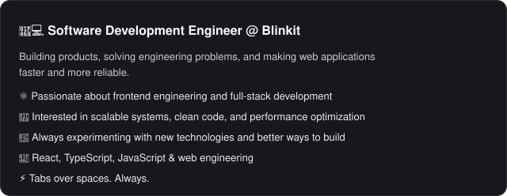

<table>
<tr>
<td valign="middle"></td>
<td width="300" align="center" valign="middle"></td>
</tr>
</table>

<table>
<tr>
<td width="33%" valign="top" align="left">

 

</td>
<td width="33%" valign="top" align="left">

 

</td>
<td width="33%" valign="top" align="left">

 

</td>
</tr>
</table>

[GitHub](https://github.com/beeplovsharma) · [LinkedIn](https://linkedin.com/in/beeplov-sharma-017a22237) · [Instagram](https://instagram.com/beeplovsharma) · [Portfolio](https://portfolio-3d-lyart.vercel.app/)
